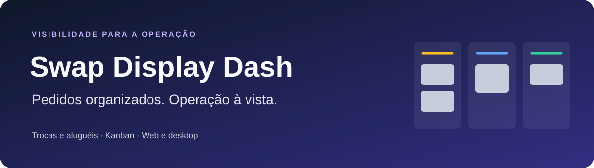

<div align="center">



**Pedidos de equipamentos organizados. Equipes com mais visibilidade.**

Painel web e aplicativo desktop para acompanhar solicitações de troca e aluguel de equipamentos.

[Começar](#executar-no-windows) · [Funcionalidades](#funcionalidades) · [Arquitetura](docs/architecture.md) · [Desktop e releases](docs/desktop.md)


[](https://github.com/SOZARADRION/swap-display-dash/actions/workflows/quality.yml)

</div>

## O projeto

O Swap Display Dash centraliza o acompanhamento de pedidos de equipamentos em uma interface Kanban, com estados de **Pendente**, **Em andamento** e **Concluído**. Trocas e aluguéis possuem painéis próprios, com atualização por eventos do Supabase Realtime.

A aplicação combina uma interface React com TanStack Start e uma distribuição desktop em Tauri. Este repositório também contém as migrações SQL que definem tabelas, permissões e funções do banco.

## Funcionalidades

| Área                | Recursos implementados no código                                          |
| ------------------- | ------------------------------------------------------------------------- |
| Monitor de trocas   | Kanban de pedidos e aviso sonoro para novos registros                     |
| Monitor de aluguéis | Visualização separada das solicitações de aluguel                         |
| Pedidos             | Cadastro de cliente, contrato, responsável e equipamento                  |
| Gestão              | Atualização de status e exclusão de pedidos conforme permissões           |
| Histórico           | Registro de alterações e exclusões                                        |
| Acesso              | Autenticação por e-mail/senha e Google, conforme configuração do Supabase |
| Usuários            | Gestão de papéis e recursos administrativos para o proprietário           |
| Desktop             | Janela nativa e integração de atualização com releases assinadas          |

**Os recursos dependem da configuração do Supabase e das permissões do banco.** O código disponível não representa uma demonstração pública com dados de teste. Não há credenciais incluídas neste guia.

## Executar no Windows

### 1. Preparar

Use **Node.js 24**, npm e Git. Para o modo web, Rust e ferramentas nativas do Windows não são necessários.

```powershell
git clone https://github.com/SOZARADRION/swap-display-dash.git
cd swap-display-dash
npm ci
Copy-Item .env.example .env
```

### 2. Configurar

Preencha `.env` com a URL e a chave **publicável** do seu projeto Supabase. O arquivo de exemplo contém apenas marcadores. Configure autenticação, URLs de redirecionamento, migrações e permissões conforme o [guia de configuração](docs/configuration.md).

### 3. Iniciar

```powershell
npm run dev
```

Abra [localhost:8080](http://localhost:8080). Não é necessário reinstalar as dependências a cada execução.

## Comandos

| Comando                 | Finalidade                                                        |
| ----------------------- | ----------------------------------------------------------------- |
| `npm run dev`           | Servidor web de desenvolvimento                                   |
| `npm run typecheck`     | Conferência dos tipos TypeScript                                  |
| `npm run lint`          | Regras ESLint de qualidade do código                              |
| `npm run format:check`  | Checagem separada de formatação com Prettier                      |
| `npm run build`         | Compilação web e preparação do HTML para o desktop                |
| `npm run preview`       | Prévia local do build, conforme configuração do Vite              |
| `npm run desktop:dev`   | Tauri em desenvolvimento; iniciar o servidor web antes            |
| `npm run desktop:build` | Gerar o aplicativo desktop com os pré-requisitos nativos          |
| `npm run format`        | Reformatar arquivos; revisar as alterações antes de salvar no Git |

O `postbuild` copia `dist/client/_shell.html` para `dist/client/index.html`, utilizado pelo Tauri. Veja o [guia desktop](docs/desktop.md) antes de gerar instaladores ou releases.

## Organização

```text
swap-display-dash/
├── .github/                  # Automações e modelos de colaboração
├── docs/                     # Arquitetura, configuração e manutenção
├── public/                   # Recursos estáticos
├── scripts/                  # Preparação do build
├── src/
│   ├── components/           # Interface e componentes reutilizáveis
│   ├── hooks/                # Acesso e comportamento compartilhado
│   ├── integrations/supabase/# Clientes e tipos do banco
│   ├── lib/                  # Utilitários e tratamento de erros
│   └── routes/               # Rotas TanStack baseadas em arquivos
├── src-tauri/                # Aplicativo Rust, configuração e ícones
└── supabase/migrations/      # Evolução do banco de dados
```

O [mapa da arquitetura](docs/architecture.md) explica as rotas e os limites entre frontend, banco e desktop. `src/routeTree.gen.ts` é gerado automaticamente. O antigo inventário `estrutura.txt` foi preservado em [docs/archive/estrutura-original.txt](docs/archive/estrutura-original.txt); a estrutura acima e os arquivos atuais são a referência.

## Qualidade e colaboração

- [Como contribuir](CONTRIBUTING.md)
- [Estado das verificações e próximos ajustes](docs/maintenance.md)
- [Cuidados com configuração e dados](SECURITY.md)

O projeto está conectado ao Lovable. Preserve o histórico publicado e trabalhe com commits novos; não use push forçado para sincronizar mudanças.

## Autor e uso

Mantido por [Adrion Sozar](https://github.com/SOZARADRION).

O repositório ainda não declara uma licença de uso. A disponibilidade pública do código não substitui uma licença; confirme com o autor antes de redistribuir ou incorporar o projeto em outro produto.
